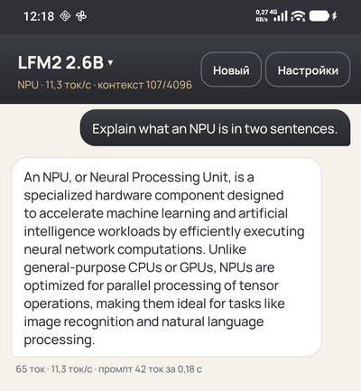
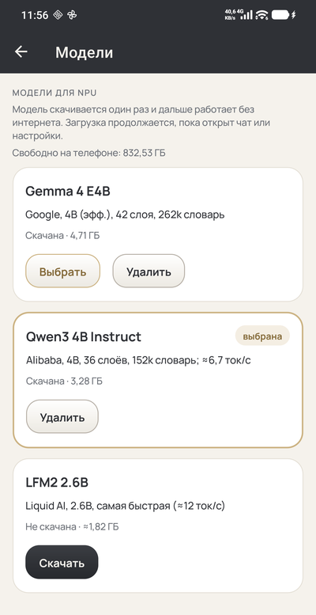

# AI_NPU — языковые модели на NPU Snapdragon прямо на телефоне

Чат-приложение для Android и набор инструментов, которые запускают LLM класса 2–4B **на нейропроцессоре
Qualcomm Hexagon** (Snapdragon 8 Gen 3, SM8650) — без облака и без интернета после загрузки модели.

- **AiNpu** — приложение .NET MAUI: выбор и загрузка моделей, чат с потоковым ответом, настройки генерации.
- **qnn-llm** — нативный рантайм (C++, QNN HTP): исполняет context binary модели по `metadata.json`.
- **qnn-llm-convert** — конвертер: модель `onnx-community` с HuggingFace → статические графы QNN → бакет HuggingFace.

Репозиторий: <https://github.com/tdav/AI_NPU> · Модели: <https://huggingface.co/tdavron>

<p>
  
  &nbsp;
  
</p>

> **English summary.** AI_NPU runs 2–4B LLMs fully on-device on the Qualcomm Hexagon NPU (Snapdragon 8 Gen 3 /
> SM8650): a .NET MAUI chat app, a metadata-driven QNN HTP runtime in C++, and a converter that turns
> `onnx-community` models into QNN context binaries (INT4 block weights, FP16 activations) and publishes them to
> HuggingFace buckets. Gemma 4 E4B, Qwen3-4B-Instruct-2507 and LFM2-2.6B are ready to download in the app.

## Содержание

- [Готовые модели](#готовые-модели)
- [Требования](#требования)
- [Приложение AiNpu](#приложение-ainpu)
- [Рантайм qnn-llm](#рантайм-qnn-llm)
- [Конвертер qnn-llm-convert](#конвертер-qnn-llm-convert)
- [Как это устроено](#как-это-устроено)
- [Структура репозитория](#структура-репозитория)
- [Ограничения](#ограничения)
- [Лицензии](#лицензии)

## Готовые модели

Все модели собраны `qnn-llm-convert` под SM8650 (Hexagon v75), QAIRT 2.40.0.251030, контекст 4096 токенов,
веса INT4 (блоки по 32), активации FP16. Скорость измерена на Xiaomi 23117RK66C (Snapdragon 8 Gen 3, 24 ГБ).

| Модель | Бакет HuggingFace | Размер | Decode | Prefill | Сверка с исходным ONNX |
|---|---|---|---|---|---|
| [Gemma 4 E4B](https://huggingface.co/onnx-community/gemma-4-E4B-it-ONNX) (текст) | [tdavron/gemma-4-e4b-it-q4-qnn-sm8650-bucket](https://huggingface.co/buckets/tdavron/gemma-4-e4b-it-q4-qnn-sm8650-bucket) | 4,71 ГБ | ≈5,5 ток/с | ≈180 ток/с | top-1 13/13, KL 0,004 |
| [Qwen3-4B-Instruct-2507](https://huggingface.co/onnx-community/Qwen3-4B-Instruct-2507-ONNX) | [tdavron/qwen3-4b-instruct-2507-q4-qnn-sm8650-bucket](https://huggingface.co/buckets/tdavron/qwen3-4b-instruct-2507-q4-qnn-sm8650-bucket) | 3,28 ГБ | ≈6,7 ток/с | ≈115 ток/с | top-1 13/13, KL 0,029 |
| [LFM2-2.6B](https://huggingface.co/onnx-community/LFM2-2.6B-ONNX) | [tdavron/lfm2-2.6b-q4-qnn-sm8650-v2-bucket](https://huggingface.co/buckets/tdavron/lfm2-2.6b-q4-qnn-sm8650-v2-bucket) | 1,82 ГБ | ≈11–12 ток/с | ≈500 ток/с | те же графы, что в первой сборке: top-1 25/25, KL 0,007 |
| LFM2-2.6B (первая ручная сборка) | [tdavron/lfm2-2.6b-q4-qnn-sm8650-bucket](https://huggingface.co/buckets/tdavron/lfm2-2.6b-q4-qnn-sm8650-bucket) | 1,83 ГБ | ≈11 ток/с | — | архив: без `metadata.json`, приложением не поддерживается |

Сверка — teacher forcing на промпте длиннее 512 токенов: совпадение самого вероятного токена и KL-дивергенция
логитов собранной модели (в onnxruntime, до компиляции) относительно исходного ONNX.

Каждый бакет содержит `metadata.json` (описание графов, тензоров, файлов с размерами и SHA256), части модели
`part*.bin` (context binary QNN), эмбеддинги, таблицы RoPE, токенизатор и шаблон чата исходной модели.

## Требования

**Телефон:** Snapdragon 8 Gen 3 (SM8650), Android 12+ (API 31), 2–5 ГБ свободного места на модель
(проверено на телефоне с 24 ГБ ОЗУ).
Другие SoC не поддерживаются: context binary привязан к архитектуре NPU (см. [Ограничения](#ограничения)).

**Сборка приложения:** .NET 11 SDK с workload `maui-android`, Android SDK (API 37).

**Рантайм:** Android NDK r29, заголовки QNN из QAIRT SDK 2.40.0.251030.

**Конвертер:** Linux или WSL2 (Windows 11 — через обёртку), Python 3.10, QAIRT SDK 2.40.0.251030 (скачивается
с сайта Qualcomm, в репозиторий не входит), 32 ГБ свободной ОЗУ, ~60 ГБ на диске для модели 4B, токен HuggingFace.

## Приложение AiNpu

### Возможности

- **Модели** — каталог с размерами и состоянием; «Скачать / Пауза / Продолжить» (докачка через HTTP Range,
  зеркала hf-mirror.com и huggingface.co, проверка SHA256 каждого файла), «Выбрать», «Удалить». Загрузка идёт
  в фоне и не прерывается при переходе в чат или настройки.
- **Обновления** — приложение сверяет `metadata.json` с бакетом; если модель пересобрана, по «Обновить»
  скачиваются только изменившиеся файлы.
- **Чат** — потоковый ответ, «Стоп», новый диалог, скорость и заполнение контекста в шапке; при переполнении
  контекст пересобирается с последних реплик.
- **Настройки** — температура, min-p, штраф за повторы, длина ответа, системный промпт.
- Токенизатор (byte-level BPE и SentencePiece-подобный BPE) и шаблон чата — на C#, по `tokenizer.json` и
  `metadata.json` модели; проверены на 1061 тестовом примере против HuggingFace `tokenizers`.

### Сборка и установка

```bash
# отладочная сборка и установка на подключённый телефон
dotnet build AiNpu/AiNpu.csproj -f net11.0-android37.0 -t:Install

# подписанный APK (пароль передаётся через переменную окружения, в проект не попадает)
export AINPU_KS_PASS=...
dotnet publish AiNpu/AiNpu.csproj -f net11.0-android37.0 -c Release \
  -p:AndroidKeyStore=true -p:AndroidSigningKeyStore=/path/ainpu-release.keystore -p:AndroidSigningKeyAlias=ainpu \
  -p:AndroidSigningStorePass=env:AINPU_KS_PASS -p:AndroidSigningKeyPass=env:AINPU_KS_PASS -o artifacts/apk
# → artifacts/apk/com.tdavron.ainpu-Signed.apk
```

Нативные библиотеки лежат в `AiNpu/Platforms/Android/qnn/arm64-v8a` (см. `VERSIONS.txt` там же): `libqnn-llm.so`
из этого репозитория и рантайм QNN 2.40 (`libQnnHtp.so`, `libQnnSystem.so`, `libQnnHtpV75Stub.so`,
`libQnnHtpV75Skel.so`). Модели в APK не входят — они скачиваются в `files/models/<id>` приложения.

### Тесты

```bash
dotnet test AiNpu.Tests   # токенизатор и шаблоны чата: LFM2, Gemma 4, Qwen3
```

## Рантайм qnn-llm

`native/qnn-llm` — библиотека `libqnn-llm.so` (Android arm64) с C-API, которую вызывает приложение (P/Invoke),
и консольная утилита `qnn-llm-cli` для проверки модели через adb.

```c
QnnLlmEngine *QnnLlmCreate(const char *libDir, const char *modelDir);   // загрузка частей модели в NPU
int  QnnLlmAppend(QnnLlmEngine *e, const int *ids, int count);          // prefill (AR-128) / decode (AR-1)
int  QnnLlmSample(QnnLlmEngine *e, float temperature, float minP, float repetitionPenalty, uint64_t seed);
int  QnnLlmNPast(QnnLlmEngine *e);  int QnnLlmContextLength(QnnLlmEngine *e);  int QnnLlmVocabSize(QnnLlmEngine *e);
void QnnLlmReset(QnnLlmEngine *e);  void QnnLlmDestroy(QnnLlmEngine *e);
const char *QnnLlmCreateError(void);  const char *QnnLlmLastError(QnnLlmEngine *e);
```

Рантайм ничего не знает об архитектуре модели: из `metadata.json` он берёт части и графы, роли входов и выходов
(эмбеддинги, маски, RoPE, KV-кэши, состояния свёрток, logits) и сам ведёт кэши и позиции. Голосование за
производительность HTP (burst, DCVS v3) включается при загрузке — без него decode в 3 раза медленнее.

```bash
cd native/qnn-llm
./build.sh                                   # → AiNpu/Platforms/Android/qnn/arm64-v8a/libqnn-llm.so + build/qnn-llm-cli
PY=python3 ./device_run.sh <каталог пакета модели> "Привет! Кто ты?" 128   # прогон на телефоне через adb
```

## Конвертер qnn-llm-convert

```bash
pip install -r converter/requirements.txt
PYTHONPATH=converter python -m qnnllm \
  --url https://huggingface.co/onnx-community/Qwen3-4B-Instruct-2507-ONNX --quant q4 \
  --qairt ~/qairt/qairt/2.40.0.251030
```

Шаги (повторный запуск продолжает с незавершённого; `--from-step` — начать с нужного):

| Шаг | Что делает |
|---|---|
| `download` | скачивает конфиг, токенизатор и выбранный вариант ONNX (`model_q4.onnx` + данные) |
| `build` | адаптер архитектуры строит статические ONNX-графы частей и энкодинги INT4, вычисляет эмбеддинги и RoPE |
| `verify` | сравнивает собранные графы с исходной моделью в onnxruntime (top-1, KL) |
| `compile` | `qairt-converter` → DLC, `qnn-context-binary-generator` → один context binary на часть (общие веса AR-128 и AR-1) |
| `package` | `metadata.json`, файлы модели, README с результатами сверки и SHA256 |
| `upload` | создаёт бакет `<пользователь>/<модель>-<quant>-qnn-<soc>-bucket` и загружает пакет |

Основные параметры: `--url`, `--quant` (q4), `--soc` (SM8550, SM8650, SM8750, SM8850), `--context` (4096),
`--qairt`, `--work`, `--bucket`, `--private`, `--no-upload`, `--skip-verify`, `--verify-steps`, `--from-step`.

**Поддерживаемые архитектуры:** LFM2 / LFM2.5 (гибрид свёрток и attention), Qwen3 (общий адаптер
transformers.js-декодеров), Gemma 4 E2B/E4B (текстовая часть: per-layer embeddings, скользящее окно,
общий KV-кэш).

**Windows 11 x64:** `converter/win` собирается в один `qnn-llm-convert.exe` (`dotnet publish`), который при
первом запуске ставит uv, Python 3.10 и зависимости. QAIRT 2.40 для Windows не умеет компилировать context
binary под мобильные NPU («Unsupported HTP Arch 75»), поэтому шаг `compile` выполняется Linux-версией QAIRT в WSL:

```bat
qnn-llm-convert.exe --url https://huggingface.co/onnx-community/LFM2-2.6B-ONNX --quant q4 ^
  --qairt C:\Qualcomm\AIStack\QAIRT\2.40.0.251030 --wsl-qairt ~/qairt/qairt/2.40.0.251030
```

Подробности — в [docs/qnn-llm-convert.md](docs/qnn-llm-convert.md).

## Как это устроено

Экспорт `onnx-community` рассчитан на onnxruntime: динамические формы, растущий KV-кэш, операции
`com.microsoft` (MatMulNBits, GroupQueryAttention, RotaryEmbedding, GatherBlockQuantized). NPU требует
статических форм и стандартных операций, поэтому конвертер **строит граф заново** по весам и семантике
исходной модели:

```
 onnx-community (q4)            qnn-llm-convert                               телефон
┌──────────────────┐   ┌─────────────────────────────────────┐   ┌──────────────────────────────┐
│ model_q4.onnx    │──▶│ адаптер архитектуры → части по слоям │   │ AiNpu (MAUI, C#)             │
│ MatMulNBits, GQA │   │ статические графы AR-128 и AR-1     │   │  токенизатор, шаблон чата    │
│ tokenizer.json   │   │ INT4 block-32 энкодинги + FP16      │   │        │ P/Invoke            │
└──────────────────┘   │ проверка в onnxruntime              │   │ libqnn-llm.so (C++)          │
                       │ qairt-converter → context binary    │──▶│  эмбеддинги, RoPE, маски,    │
                       │ metadata.json → бакет HuggingFace   │   │  KV-кэши по metadata.json    │
                       └─────────────────────────────────────┘   │        │ QNN HTP             │
                                                                 │ Hexagon v75 NPU (part*.bin)  │
                                                                 └──────────────────────────────┘
```

- **Веса.** Линейные слои — MatMul «FP16 × INT4» с блоками по 32 (энкодинги `PER_BLOCK` через
  `--quantization_overrides`). HTP v75 принимает только симметричные блоки со знаком (−8…7, положительный
  scale), поэтому блоки с zero point и с отрицательным scale переквантуются по минимуму MSE; качество
  проверяется в onnxruntime до компиляции.
- **Части.** Модель режется по слоям на context binary по ~0,5 ГБ; в каждом два графа с общими весами:
  AR-128 для prefill и AR-1 для decode.
- **KV-кэш** фиксированного размера (P слотов) живёт у хоста: граф получает `past_*`, а возвращает только новые
  K/V. Внимание считается раздельно по прошлым и новым позициям — склеиваются только scores, а не кэш:
  это ускорило decode Qwen3 с 2,9 до 6,7 ток/с (микротест слоя: 3,06 → 0,47 мс).
- **Хост** считает эмбеддинги (INT4/FP16 таблицы), маски, RoPE, кольцевые кэши скользящего окна и состояния
  свёрток LFM2; буферы по возможности выделяются в общей памяти (`rpcmem` + `memRegister`), чтобы FastRPC
  не копировал их на каждом шаге.

## Структура репозитория

```
AiNpu/                         приложение .NET MAUI (Android)
  Features/Chat|Models|Settings  экраны чата, моделей и настроек
  Services/                    QnnLlmEngine (P/Invoke), ChatService, HfTokenizer, ChatTemplate,
                               ModelCatalog, ModelManager, ModelDownloads, GenerationSettings
  Platforms/Android/qnn/       libqnn-llm.so и библиотеки QNN 2.40 (arm64-v8a)
AiNpu.Tests/                   xUnit: токенизатор и шаблоны чата на эталонах HuggingFace
native/qnn-llm/                рантайм: qnn_llm.cc (движок + C-API), qnn_core.inc (загрузка QNN, burst,
                               общая память), qnn_llm_cli.cc, build.sh, device_run.sh
converter/qnnllm/              конвертер: cli, hub, q4 (INT4), graph (построитель ONNX), host (эталонный хост),
                               build, qairt, readme; arch/ — адаптеры gemma4, tjs_decoder (LFM2, Qwen3)
converter/win/                 обёртка qnn-llm-convert.exe для Windows
docs/                          документация конвертера, скриншоты
```

## Ограничения

- **Только SM8650 (Hexagon v75).** Context binary компилируется под конкретную архитектуру NPU. Конвертер
  умеет SM8550/SM8750/SM8850 (`--soc`), но готовые модели и приложение собраны и проверены только для SM8650.
- **QAIRT 2.40.0.251030.** Модели и библиотеки QNN в приложении должны быть одной версии — другой
  `libQnnHtp.so` не загрузит context binary.
- **Только текст.** У Gemma 4 зрение и звук не конвертируются.
- **Контекст 4096 токенов** (задаётся при конвертации, `--context`).
- **Общая память на v75 ограничена:** у DSP 32-битное адресное пространство, поэтому KV-кэши крупных моделей
  регистрируются частично (остальные буферы идут обычным путём); полный zero-copy возможен на v81+.
- Отладочная и Release-сборки подписаны разными ключами: при переходе между ними приложение нужно удалить
  (вместе со скачанными моделями).

## Лицензии

- Модели распространяются на условиях исходных лицензий: Gemma — [Gemma Terms of Use](https://ai.google.dev/gemma/terms),
  Qwen3 — Apache 2.0, LFM2 — [LFM Open License](https://huggingface.co/LiquidAI/LFM2-2.6B). Бакеты содержат
  изменённые (переквантованные и пересобранные) веса, см. README каждого бакета.
- Библиотеки QNN (`libQnn*.so`) — Qualcomm AI Engine Direct SDK, распространяются по лицензии Qualcomm.
- `native/qnn-llm/third_party/json.hpp` — nlohmann/json (MIT).
